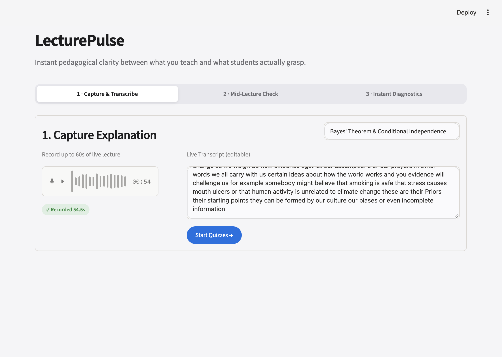
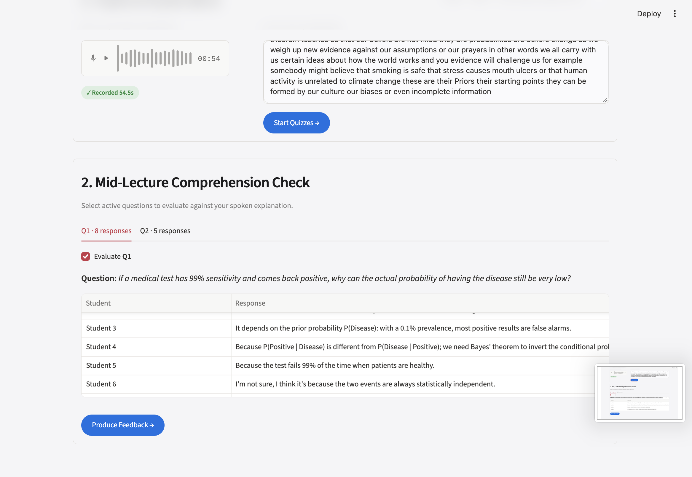
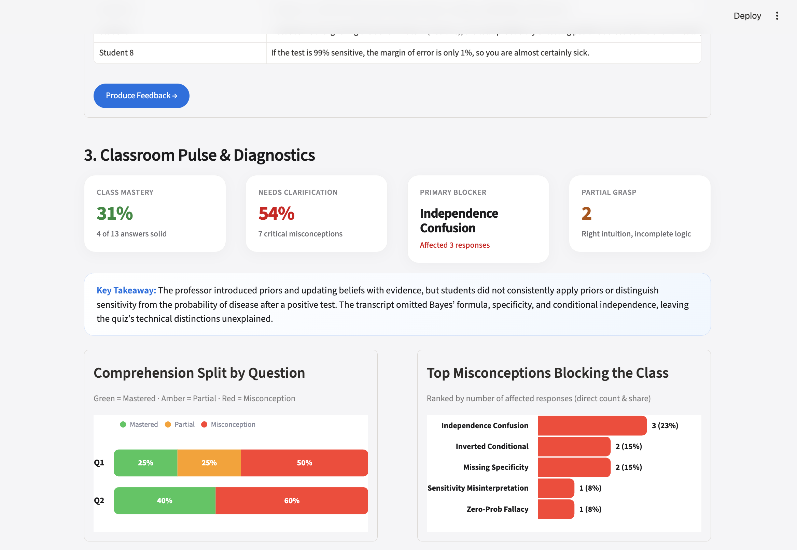

# LecturePulse — Real-Time Pedagogical Diagnostics

**LecturePulse** is a closed-loop AI teaching assistant built to bridge the gap between what an instructor explains live in class and what students actually understand.

## Workflow & App Preview

### 1. Live Lecture Capture & Transcription
Records up to 60 seconds of a live explanation and converts speech into an editable transcript.

### 2. Mid-Lecture Comprehension Check
Human-in-the-loop interface allowing the instructor to review collected student responses and select active diagnostic questions.

### 3. Diagnostic Dashboard & 1-Second EDA Insights
Cross-references the spoken lecture against student answers to surface mastery rates, root-cause misconceptions, and live classroom interventions.

## Key Features
- **Live Speech-to-Text Capture:** Records up to 60 seconds of a lecture segment and transcribes it automatically.
- **Human-in-the-Loop Comprehension Check:** Lets instructors review transcripts and launch targeted mid-lecture diagnostic quizzes.
- **LLM-Powered Reasoning & Triangulation:** Cross-references the spoken lecture transcript against individual student answers via OpenRouter to classify mastery levels and isolate root-cause misconceptions.
- **Executive EDA Visual Analytics:** Built with Pandas and Altair to display normalized comprehension splits, Pareto misconception rankings, and a student-by-question pulse matrix.

## Tech Stack
- **Frontend & UI:** Streamlit
- **Data & Visual Analytics:** Pandas, Altair
- **AI & Speech:** OpenRouter API, SpeechRecognition

## Quick Start

1. Clone the repository and enter the folder:

       git clone https://github.com/SufienSadgal/Real-Time-Classroom-Analytics.git
       cd Real-Time-Classroom-Analytics

2. Create and activate a virtual environment:

       python3 -m venv .venv
       source .venv/bin/activate

3. Install dependencies:

       pip install -r requirements.txt

4. Configure your API key:

       cp .env.example .env
       # Paste your OpenRouter API key inside .env

5. Run the application:

       streamlit run app.py
